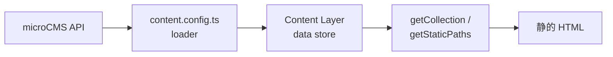

# Astro × microCMSでブログを作る — Content Loaderの基礎

## Content Loader とは

- Astro の静的サイト生成と microCMS を組み合わせると、「編集は CMS、配信は静的 HTML」と役割分担しやすい
- Astro 5 以降の **Content Layer** では、各コレクションに **loader**（データの取り込み方）を付ける
- loader がビルド時（および `astro dev` 起動時）にデータを集め、内部の data store に保存する
- ページ側ではこれまでどおり `getCollection()` などで取り出す
- 本記事では「なぜ loader が必要か」「どう書けば CMS の記事をページに出せるか」に焦点を当てる



| 管理方法 | データの置き場 | 取り込み方 |
|---|---|---|
| ローカル Markdown | `src/content/` などのファイル | 公式の `glob` / `file` loader |
| microCMS など CMS | リモート API | カスタム loader（またはコミュニティ製） |

- どちらも最終的には型付きコレクションになる — 一覧・詳細の書き方はほぼ共通
- 違うのは **誰が・いつ・どこから中身を供給するか**

## 事前準備

### Astro プロジェクトと SDK

```bash
npm create astro@latest
npm install microcms-js-sdk
```

### microCMS 側

- **blogs**（リスト型）: `title` / `body`（リッチエディタ）など
- **tags**（リスト型、任意）: `title` / `slug` など — 記事とコンテンツ参照で紐づける
- 管理画面の **サービスドメイン** と **API キー** を環境変数に設定する

```bash
# .env
MICROCMS_SERVICE_DOMAIN=your-service
MICROCMS_API_KEY=your-api-key
```

- `.env` は Git に含めない — ローカルと CI / ホスティング側のそれぞれで設定する

## Content Collections と loader の基礎

コレクション定義は `src/content.config.ts` に書く。中心になる API は次のとおり。

- **`defineCollection`**: 1 つのコレクション（例: `blogs`）の定義
- **`loader`**: エントリの取得方法（必須）
- **`schema`**: Zod などによる形の定義（任意だが推奨）— 型生成と実行時バリデーションに効く

```ts
import { defineCollection } from 'astro:content';
import { z } from 'astro/zod';
import { glob } from 'astro/loaders';

// ローカル Markdown の例（公式 loader）
const blog = defineCollection({
  loader: glob({ pattern: '**/*.md', base: './src/data/blog' }),
  schema: z.object({
    title: z.string(),
    description: z.string().optional(),
  }),
});

export const collections = { blog };
```

### loader の二形態

| 形態 | 概要 | 向いている用途 |
|---|---|---|
| **関数型** | `async () => entries` のように配列を返す | API を一括取得してそのまま載せたいとき |
| **オブジェクト型** | `load({ store, ... })` で store を更新 | 増分更新やキャッシュ制御など細かい制御が必要なとき |

- microCMS の全件取得なら、関数型で十分なことが多い
- **`glob` / `file`**: ローカルファイル向けの組み込み loader
- **カスタム loader**: `fetch` や SDK で任意ソースから返す関数（またはオブジェクト）

> 参照: [Content Collections](https://docs.astro.build/en/guides/content-collections/) / [Content Loader API](https://docs.astro.build/en/reference/content-loader-reference/) / [Content Layer: A Deep Dive](https://astro.build/blog/content-layer-deep-dive/)

## microCMS 用カスタム loader

関数型 loader でリスト API を取り込む最小構成のイメージ。

```ts
// src/content.config.ts
import { defineCollection } from 'astro:content';
import { z } from 'astro/zod';
import { createClient } from 'microcms-js-sdk';

const serviceDomain = import.meta.env.MICROCMS_SERVICE_DOMAIN;
const apiKey = import.meta.env.MICROCMS_API_KEY;

if (!serviceDomain || !apiKey) {
  throw new Error(
    'MICROCMS_SERVICE_DOMAIN and MICROCMS_API_KEY must be set in the environment.',
  );
}

const client = createClient({
  serviceDomain,
  apiKey,
});

const microCMSDateFields = {
  createdAt: z.string(),
  updatedAt: z.string(),
  publishedAt: z.string(),
  revisedAt: z.string(),
};

const tagSchema = z.object({
  id: z.string(),
  title: z.string(),
  slug: z.string(),
  ...microCMSDateFields,
});

/** endpoint を受け取り、その API の全件を返す loader を生成する */
const microCMSLoader = (endpoint: string) => {
  return async () => {
    const contents = await client.getAllContents({ endpoint });
    return contents;
  };
};

const blogs = defineCollection({
  loader: microCMSLoader('blogs'),
  schema: z.object({
    title: z.string(),
    body: z.string(),
    tags: z.array(tagSchema).optional().default([]),
    ...microCMSDateFields,
  }),
});

const tags = defineCollection({
  loader: microCMSLoader('tags'),
  schema: tagSchema,
});

export const collections = { blogs, tags };
```

ポイントは次のとおり。

1. **loader は「配列を返す非同期関数」でよい** — 各要素に一意な `id` があればエントリとして扱える
2. **schema は CMS のフィールドと揃える** — リッチエディタ本文は多くの場合 HTML 文字列
3. **コレクションを分けてよい** — `blogs` と `tags` を分けるとタグ一覧やフィルタが書きやすい

> 参照: [microCMS JavaScript SDK](https://github.com/microcmsio/microcms-js-sdk) / [microcms-astro-loader](https://github.com/morinokami/microcms-astro-loader)

## ページでの利用

loader で取り込んだあとは、通常の Content Collections と同じ。

### 記事一覧

```astro
---
// src/pages/index.astro
import { getCollection } from 'astro:content';

const posts = (await getCollection('blogs')).sort(
  (a, b) =>
    new Date(b.data.publishedAt).valueOf() -
    new Date(a.data.publishedAt).valueOf(),
);
---

<ul>
  {
    posts.map((post) => (
      <li>
        <a href={`/blog/${post.id}/`}>{post.data.title}</a>
      </li>
    ))
  }
</ul>
```

- `post.data` には schema で定義したフィールドが入る
- `post.id` はエントリの ID（多くの場合 microCMS のコンテンツ ID）

### 記事詳細（動的ルート）

```astro
---
// src/pages/blog/[...slug].astro
import { type CollectionEntry, getCollection } from 'astro:content';

export async function getStaticPaths() {
  const posts = await getCollection('blogs');
  return posts.map((post) => ({
    params: { slug: post.id },
    props: post,
  }));
}

type Props = CollectionEntry<'blogs'>;
const post = Astro.props;
---

<article>
  <h1>{post.data.title}</h1>
  <div set:html={post.data.body} />
</article>
```

- `getStaticPaths` で全記事分のパスを列挙し、ビルド時に静的ページを生成する
- 本文が HTML のときは `set:html` で出力する — XSS に注意し、信頼できる CMS 出力を前提にする
- コアの流れは「loader で取る → `getCollection` で読む → ページに渡す」

## ビルド時取得であることの意味

この構成の Content Collections は、原則として **ビルド（および開発サーバー起動）時点のスナップショット**。

- microCMS で記事を更新しても、再ビルドするまで本番 HTML には反映されない
- ホスティング側では、CMS の Webhook でビルドをキックする運用が一般的
- リクエスト時に最新を取りたい場合は、Astro の Live Collections など別の仕組みがある
- 「常に最新を SSR で取る」のか「静的に固めて CDN 配信する」のかで、loader の選び方やインフラが変わる

## まとめ

- Astro の Content Layer では、**loader がコンテンツの供給源**になる
- microCMS は SDK で全件取得する **カスタム loader** を `defineCollection` に渡す
- **schema** でフィールドを固定すると、型とバリデーションの両方で安心できる
- 一覧・詳細は既存の Collections / `getStaticPaths` の知識がそのまま活きる
- データはビルド時のスナップショット — 更新反映には再ビルド（＋必要なら Webhook）が前提
- まずは関数型 loader と最小の一覧・詳細から始め、必要ならタグ・画像最適化・コミュニティ製 loader へ広げる
