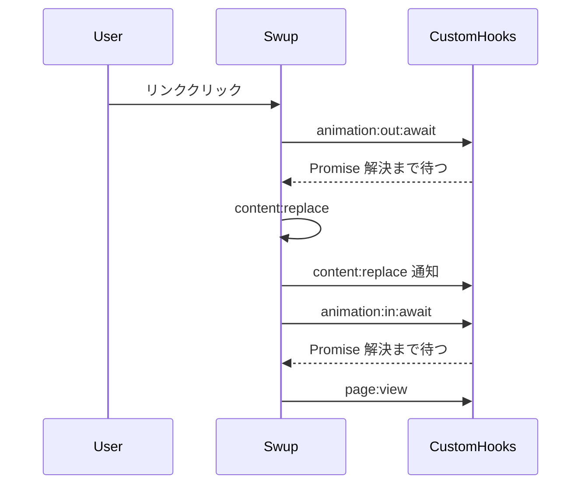

# Astro + Swup モザイク遷移アニメ実装ガイド

  

このリポジトリの実装を手本に、Astro と Swup でページを差し替える仕組みと、その上で GSAP が担うモザイク遷移アニメを解説する。

  

構成:

  

1. **Astro × Swup** … SPA 風のページ差し替えとフック

2. **GSAP アニメ** … ピクセル幕 cover / reveal とパネル変数

  

見た目の基準は [Codrops Pixel Transition Demo 1](https://tympanus.net/Development/PixelTransition/index.html)。公式 Swup テーマ（fade / slide など）は使わない。

  

---

  

## 1. 概要とファイル構成

  

| ファイル | 層 | 役割 |

|---|---|---|

| `astro.config.mjs` | Swup | `@swup/astro` の統合オプション |

| `src/layouts/BaseLayout.astro` | Swup | 永続シェル（Header / `#swup` / Footer / overlay）とスクリプト読込 |

| `src/scripts/swup-mosaic.ts` | Swup | Swup 準備待ち・フック配線・方向判定・ナビ同期 |

| `src/scripts/mosaic.ts` | GSAP | グリッド生成、`cover` / `reveal` / `prepareIncomingMain` |

| `src/scripts/mosaic-pane.ts` | GSAP | 制御パネル → CSS 変数反映、プレビュー |

| `src/components/Header.astro` | 両方 | ナビ（Swup 永続）+ 遷移パラメータのパネル UI |

| `src/styles/global.css` | 両方 | レイアウト／overlay スタイルとアニメ用 CSS 変数 |

  

依存は `package.json` の `@swup/astro` と `gsap`。

  

---

  

## 2. Astro × Swup — ページ差し替えのしくみ

  

Astro は通常、リンクごとにフルページを読み込む。`@swup/astro` を入れると、指定した DOM だけを取得・差し替えし、Header などはそのまま残る。アニメは Swup のフックの「待ち」に自前の Promise を差し込む形で載せる。

  

### 役割分担

  

| 担当 | やること |

|---|---|

| **Swup** | リンク傍受、次ページ HTML の取得、container の差し替え、フックの発火、History、preload |

| **自前スクリプト** | `animation:out` / `animation:in` で「いつまで待つか」、差し替え直後の DOM 準備、ナビ同期 |

  

本リポジトリではテーマや CSS クラス駆動アニメを切り、待ち時間の制御をすべて自前にしている。

  

### Step 1. 依存と設定

  

```bash

npm install @swup/astro gsap

```

  

`astro.config.mjs`:

  

```js

import swup from '@swup/astro';

  

export default defineConfig({

  integrations: [

    swup({

      theme: false,           // 組み込みテーマなし

      animationClass: false,  // CSS クラス駆動アニメなし

      containers: ['main'],   // <main> だけ差し替え

      globalInstance: true,   // window.swup を公開

      updateBodyClass: true,

      accessibility: true,

      preload: true,

      loadOnIdle: false,      // idle 待ちせず早めに初期化

    }),

  ],

});

```

  

| オプション | 意味 |

|---|---|

| `theme: false` | fade 等の公式テーマを使わない |

| `animationClass: false` | `is-changing` 系の CSS 待ちに頼らない |

| `containers: ['main']` | 差し替え範囲を `<main>` に限定 |

| `globalInstance: true` | フック接続のため `window.swup` を公開 |

| `updateBodyClass: true` | `page-home` など body class を次ページに合わせる |

| `loadOnIdle: false` | 初期化を早め、フックを早く結べるようにする |

  

### Step 2. レイアウトを「差し替え」と「永続」に分ける

  

`BaseLayout.astro`:

  

- **差し替え対象**: `<main id="swup" class="site-main">`（`containers: ['main']` と一致）

- **永続**: Header、Footer、`#mosaic-overlay`（body 直下・container 外）

- クライアントスクリプトはレイアウトで一度だけ読む

  

```astro

<body class={pageClass}>

  <Header current={current} />

  <main id="swup" class="site-main">

    <slot />

  </main>

  <Footer />

  <div id="mosaic-overlay" aria-hidden="true"></div>

  <script>

    import '../scripts/swup-mosaic.ts';

    import '../scripts/mosaic-pane.ts';

  </script>

</body>

```

  

`id="swup"` は後段の GSAP が main を探すための参照用。Swup のセレクタは `main`。

  

### Step 3. 遷移ライフサイクルとフック

  

リンククリック後の流れ（アニメの中身は次章）:

  



  

本リポジトリの配線（`swup-mosaic.ts`）:

  

```ts

swup.options.animateHistoryBrowsing = true; // Back でも out/in を走らせる

  

swup.hooks.replace('animation:out:await', async (visit) => {

  await cover({ reverse: isReverseVisit(visit) });

});

  

swup.hooks.on('content:replace', (visit) => {

  if (visit) prepareIncomingMain({ reverse: isReverseVisit(visit) });

});

  

swup.hooks.replace('animation:in:await', async (visit) => {

  await reveal({ reverse: isReverseVisit(visit) });

});

  

swup.hooks.on('page:view', () => {

  syncNavCurrent();

});

```

  

要点:

  

- **`hooks.replace`** … デフォルト待ちを上書きし、返した Promise が解決するまで次段階に進まない

- **`hooks.on`** … 副作用用。待ちにはならない（`content:replace` 直後の DOM セットやナビ同期向き）

- **Back でもアニメ** … デフォルトは popstate でアニメをスキップする。`animateHistoryBrowsing = true` が必須

- **方向フラグ** … `visit.history.popstate && visit.history.direction === 'backwards'` のときだけ reverse（GSAP 側へ渡す）

- **`window.swup` 待ち** … ポーリングと `swup:enable` の両方で準備完了を待つ

  

### Step 4. Header が残るときのナビ同期

  

Header は container 外のため、サーバー描画の `aria-current` は遷移後に古いままになる。`page:view` でパスを見て付け替える。

  

---

  

## 3. GSAP — モザイク遷移アニメ

  

Swup が「いつ差し替えるか」を決めたうえで、**見た目**は GSAP（`mosaic.ts`）が担う。公式テーマは使わず、ピクセルグリッドで画面を覆い・開く。

  

### 画面上の 2 層

  

1. **ピクセル幕（`#mosaic-overlay`）** … 全画面を `cols × rows` のセルで覆い、出現 → 消滅する

2. **本文（`#swup`）** … 旧ページがフェード＋スライドで退場し、新ページが別位置から入場する

  

セルと main は cover / reveal 各段階で `Promise.all` により**並列**。どちらか遅い方がその段階の待ち時間になる。

  

### cover → replace → reveal

  

| 段階 | Swup フック | GSAP がやること |

|---|---|---|

| **cover** | `animation:out:await` | スクロールロック。セル scale 0→1.01・opacity 0→1。同時に旧 main を `yPercent` 方向へ退出し opacity 0 |

| **差し替え直後** | `content:replace` | 新 main を入場開始位置 + opacity 0 に即セット（フラッシュ防止）。`prepareIncomingMain` |

| **reveal** | `animation:in:await` | セル scale→0・opacity→0。同時に新 main を `yPercent: 0`・opacity 1 へ。overlay を空にしてスクロール解除 |

  

### Forward と Reverse

  

| | Forward（通常クリック・進む） | Reverse（ブラウザ Back のみ） |

|---|---|---|

| セルの cascade | 上の行 → 下の行 | 下の行 → 上の行 |

| cover の origin | `50% 0%`（上辺から膨らむ） | `50% 100%`（下辺から） |

| reveal の origin | `50% 100%` | `50% 0%` |

| 旧 main の退出 | `+Y`（下方向） | `−Y`（上方向） |

| 新 main の入場開始 | `−Y`（上から入る） | `+Y`（下から入る） |

  

### スタッガー（波の伝わり方）

  

```ts

base * (cell.row + gsap.utils.random(0, randomMax))

```

  

行番号が大きいほど遅く始まり、ランダム項で行内にばらつきが出る。reverse 時はセル配列を末尾から処理し、下の行が先に動く。

  

### CSS 変数と getConfig

  

タイミング・グリッド・移動量は `:root` の CSS 変数。`cover` / `reveal` 開始時に `getConfig()` が読む。

  

`global.css` のデフォルト:

  

```css

:root {

  --mosaic-cols: 14;

  --mosaic-rows: 8;

  --mosaic-color: #000000;

  --mosaic-cell-duration: 400ms;

  --mosaic-stagger-base: 30ms;

  --mosaic-stagger-random: 5;

  

  --content-duration: 800ms;

  --content-out-y: 15;

  --content-in-y: 25;

}

```

  

overlay は fixed 全画面グリッド。セルは初期 `scale: 0` / `opacity: 0`。遷移中は `html.is-page-transitioning` でスクロールをロックする。

  

### reduced-motion

  

`prefers-reduced-motion: reduce` のときはグリッドを作らず、単色 overlay + 約 120ms 待ちの簡易カバーにしてから差し替え・解除する。

  

### 実装の対応関係

  

1. **`getConfig()`** … CSS 変数 → 数値

2. **`cover({ reverse })`** … グリッド生成 → セル出現 + main 退出

3. **`prepareIncomingMain({ reverse })`** … 差し替え直後の新 main を入場開始位置へ

4. **`reveal({ reverse })`** … セル消滅 + 新 main 入場 → overlay 片付け

  

---

  

## 4. パネル変数で制御できる部分

  

§3 の GSAP アニメのうち、**見た目・テンポ・移動量**はパネル（CSS 変数）で変えられる。Swup のフック順や方向判定、reduced-motion 分岐はコード固定で、パネルからは触れない。

  

### データフロー

  

```

Header の input[data-var]

  → mosaic-pane.ts が document.documentElement に CSS 変数を書き込み

  → cover / reveal 開始時に mosaic.ts の getConfig() が読み取り

  → GSAP の duration / stagger / yPercent / グリッドサイズに反映

```

  

リロードすると `global.css` のデフォルトに戻る（永続化なし）。

  

### ピクセル幕を触る変数 — Pixels

  

| 変数 | デフォルト | 単位 | 制御する部分 |

|---|---|---|---|

| `--mosaic-cols` | `14` | なし | グリッド横分割。大きいほど幕が細かく、DOM / 描画も重い |

| `--mosaic-rows` | `8` | なし | グリッド縦分割。行が増えると cascade の段数も増える |

| `--mosaic-color` | `#000000` | 色 | セル背景＝幕の色そのもの |

| `--mosaic-cell-duration` | `400ms` | 時間 | **1セル**の scale / opacity 時間。短いほどピクセルがパッと現れ・消える |

| `--mosaic-stagger-base` | `30ms` | 時間 | 行スタッガーの基準（§3 の式の `base`）。大きいほど波がゆっくり伝わる |

| `--mosaic-stagger-random` | `5` | なし | 式の `randomMax`。`0` で整列 cascade、大きいほど有機的 |

  

調整の目安:

  

- **細かいモザイク** … cols / rows を上げる（例: 24×14）。重ければ cell-duration を少し短く

- **速い cascade** … stagger-base を下げる（例: 10–15）

- **整った波** … stagger-random を `0` 近くに

- **幕の色** … mosaic-color を背景やブランド色に合わせる

  

### 本文スライドを触る変数 — Main（`#swup`）

  

| 変数 | デフォルト | 単位 | 制御する部分 |

|---|---|---|---|

| `--content-duration` | `800ms` | 時間 | main 出入りの duration。セルより長いと「幕は終わったのに本文がまだ動いている」になりやすい（`Promise.all`） |

| `--content-out-y` | `15` | %（数値） | 退出時 `yPercent` の絶対値（forward `+Y` / reverse `−Y`） |

| `--content-in-y` | `25` | %（数値） | 入場開始 `yPercent` の絶対値（forward `−Y` / reverse `+Y` → `0`） |

  

調整の目安:

  

- **ピクセル幕を主役に** … out-y / in-y を小さく（例: 5–10）

- **スライド感を強く** … in-y を大きく（例: 30–40）

- **テンポを揃える** … cell-duration と content-duration のバランスを見る

  

### Preview ボタン

  

**Preview forward** / **Preview back** はページ遷移なしで `cover` → `reveal` を連続実行する。Swup を介さず GSAP 側だけを試せる。

  

---

  

## 5. 補足

  

- **CSS 変数方式**: デフォルトは CSS 一箇所、デモ調整はパネル、本番でもテーマやメディアクエリで上書きしやすい。

- **History Back**: Swup の `animateHistoryBrowsing` と GSAP の reverse を組み合わせ、戻る操作でも対称なモザイクを見せる。