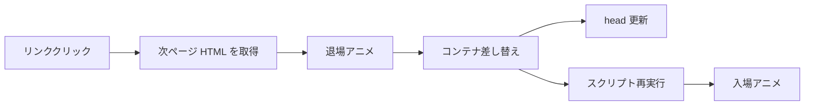
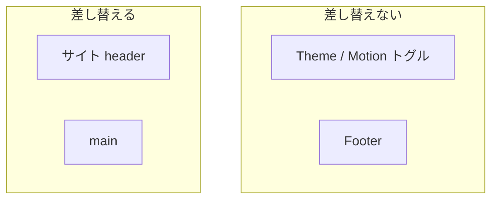

# Astroにswupを導入する — ページ遷移をスムーズにする

## swup と Astro とは

- Astro はページごとに HTML を返すマルチページ構成が基本
- 表示は速い一方、リンクのたびにフルリロードするため、「画面がつながって動く」感は出にくい
- [swup](https://swup.js.org/getting-started/) は、サーバーが描画した HTML をクライアントで取得し、指定領域だけ差し替えつつ遷移アニメをつけるライブラリ
- 公式の [Astro 向けインテグレーション](https://swup.js.org/integrations/astro/)（`@swup/astro`）を使うと、設定ファイルに足すだけで導入できる
- SPA に載せ替えるのではなく、「いまの MPA のまま体感だけなめらかにする」のがポイント



| 担当 | 役割 |
|---|---|
| Astro | ルーティング、コンテンツ、静的 HTML の生成 |
| swup | クライアントでの取得・キャッシュ・差し替え・遷移アニメ・a11y 補助 |

## `@swup/astro` のインストールと最小設定

```bash
npm install @swup/astro
```

```js
// astro.config.mjs
import { defineConfig } from 'astro/config';
import swup from '@swup/astro';

export default defineConfig({
  integrations: [swup()],
});
```

これだけで、インテグレーションが各ページにクライアントスクリプトを注入する。デフォルトの挙動は次のとおり。

- **差し替え対象**: 最初の `<main>`（`containers: ['main']`）
- **テーマ**: `fade`
- **その他**: プリロード、キャッシュ、Accessibility Plugin、`head` 更新、スクリプト再実行などが有効
- セマンティックに `<main>` で本文を囲っていれば、特別な `id="swup"` は必須ではない
- 設定後は開発サーバーを再起動し、Network 上でページ HTML が取得されているかを確認する

## 差し替えコンテナの設計

デフォルトの `main` だけでは足りないことがある。

- サイトタイトルをホームでは `<h1>`、それ以外ではリンクにする Header がある場合
- Header が `<main>` の外にあると、**遷移後も古い Header が残る**

```js
swup({
  containers: ['main', 'header'],
  theme: 'fade',
});
```

- swup は各セレクタに対して `querySelector`（先頭の一致）で要素を探す
- 記事ページに `.article-header` など別の `<header>` があっても、ドキュメント先頭のサイト用 `<header>` だけが対象
- 固定配置のテーマ切替ボタンなどは Header の外に置き、コンテナから外すと状態を保持しやすい
- ページごとに中身が変わる要素は `containers` に入れるか、`<main>` 内に収める



## ハマりどころ: ページ固有スクリプトが動かない

Astro の `<script>` はコンポーネントから抜き出され、多くの場合 **差し替えコンテナの外** に配置される。

1. 一覧ページにはそのスクリプトが存在しない
2. swup は `main` / `header` だけを差し替える
3. 記事 HTML 内の UI は来るが、初期化コードは読み込まれない
4. ボタンが `display: none` のまま、など「動かない」状態になる

`@swup/astro` は遷移後に `astro:page-load` をディスパッチする。対策は次の組み合わせが扱いやすい。

- 初期化ロジックを **全ページで読み込む共有スクリプト**（例: `BaseHead` から import）に移す
- 初回実行に加え、`document.addEventListener('astro:page-load', init)` で再初期化する
- リスナーや `IntersectionObserver` は `AbortController` などで破棄してから張り直す

```ts
function initArticleMenu() {
  // 前回分を abort してから、現在の DOM を querySelector
}

initArticleMenu();
document.addEventListener('astro:page-load', initArticleMenu);
```

- 「そのページにしかないスクリプト」は swup と相性が悪い
- 永続 UI 用のスクリプトも共有側に寄せ、遷移のたびに DOM の有無を見て早期 return する形に揃える

## アニメーション低減とコントロール UI

- 動きが苦手な利用者向けに、OS の `prefers-reduced-motion` を尊重する
- サイト側でオン／オフできるとさらに安心 — swup では訪問開始時にアニメを切るのが定石

```js
// globalInstance: true で window.swup を公開してから
swup.hooks.on('visit:start', (visit) => {
  if (window.__motionPreference?.prefersReduced()) {
    visit.animation.animate = false;
  }
});
```

```js
swup({
  containers: ['main', 'header'],
  globalInstance: true,
  theme: 'fade',
});
```

| 入力 | 反映 |
|---|---|
| `prefers-reduced-motion: reduce`（未保存時） | `html[data-motion="reduce"]`、遷移アニメなし |
| ヘッダーのトグルで明示指定 | `localStorage` に保存し、OS 設定より優先 |
| トグルで Motion に戻す | アニメあり（保存済みの意図を維持） |

- コントロール UI はアイコンボタンにし、ホバー／フォーカスでツールチップ（`aria-label` と同じ文言）を出す
- タッチしやすいよう **最小 40×40px** 程度を確保する
- CSS 側では `html[data-motion="reduce"]` で UI トランジション時間を短くするなど、遷移以外の動きも揃える

## テーマの切り替え

公式テーマは主に次の三つ。`astro.config.mjs` の `theme` を変えるだけで試せる。

| 値 | 印象 |
|---|---|
| `'fade'` | フェード — 無難で本文サイト向き |
| `'slide'` | 左右スライド |
| `'overlay'` | オーバーレイ — `['overlay', { direction: 'to-right' }]` のように方向指定も可能 |

- カスタム CSS で独自アニメにする場合は `theme: false` とし、コンテナにアニメ用クラスを付けてスタイルを書く
- アニメ不要でキャッシュやプリロードだけ欲しい場合は、`theme: false` と `animationClass: false` の組み合わせもある
- ブログやドキュメントサイトでは、派手さより読みやすさ優先で `fade` に戻す選択もよくある

## まとめ

- **`@swup/astro`** を `integrations` に足すと、Astro の MPA にページ遷移・キャッシュ・プリロードを足せる
- **ページごとに姿が変わる要素**（例: サイト Header）は `containers` に含める — 固定 UI は外に出す
- **ページ固有の `<script>` は遷移後に来ない**ことがある — 共有スクリプト + `astro:page-load` で再初期化する
- **`prefers-reduced-motion` と手動トグル**で `visit.animation.animate = false` にすると、a11y と好みの両方に応えやすい
- テーマは `fade` / `slide` / `overlay` を設定だけで切り替えられる
- まずは `swup()` のデフォルトで動かし、実サイト特有の隙間を一つずつ埋めていく

> 参照: [swup — Getting Started](https://swup.js.org/getting-started/) / [swup × Astro](https://swup.js.org/integrations/astro/) / [Hooks / Visit](https://swup.js.org/lifecycle/hooks/)
